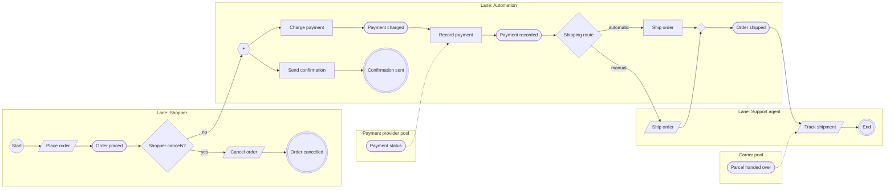

# BPMN: Order showcase

Source: Context `Sh0wCs` (Showcase), Chapter `Ch4pT1` (Order showcase). The full diagram with layout is [order-showcase.bpmn](./order-showcase.bpmn) (open in bpmn.io or Camunda Modeler).

Legend: `[/ /]` user task (Screen), `[ ]` service task (Processor), `([ ])` intermediate event, `((( )))` end event, `{ }` exclusive gateway, `{{+}}` parallel gateway, dotted arrow = message flow.

## Mapping

| Board | BPMN |
|---|---|
| Actor lane (Shopper, Support agent, Automation) | Lane of the Order showcase pool |
| Integration lane (Payment provider, Carrier) | Black-box pool, message flow |
| Command started from a Screen | User task |
| Command started from a Processor | Service task |
| Event | Intermediate throw event; end event when nothing follows |
| Screen, Query, Processor | Not in the flow: named in each task's documentation |
| Slice | Named in the documentation (e.g. Sl0001) |

## Interpretations (the model has no arrow for these)

- **Shopper cancels?**: Cancel order starts from My orders (reads Orders), not from Order placed.
- **Parallel split** after Order placed: Charge payment (Sl0004) and Send confirmation (Sl0008) both read Orders.
- **Shipping route**: Ship order (El0604) has two triggers, Pick list and Auto-ship paid orders. Shown as alternatives after Payment recorded.
- **Track shipment**: follows Order shipped and receives Parcel handed over from the Carrier. The slice has no command and no end event, so the end event is unnamed.
- **Show orders** (Sl0002) is a read slice with no command: it has no task.
